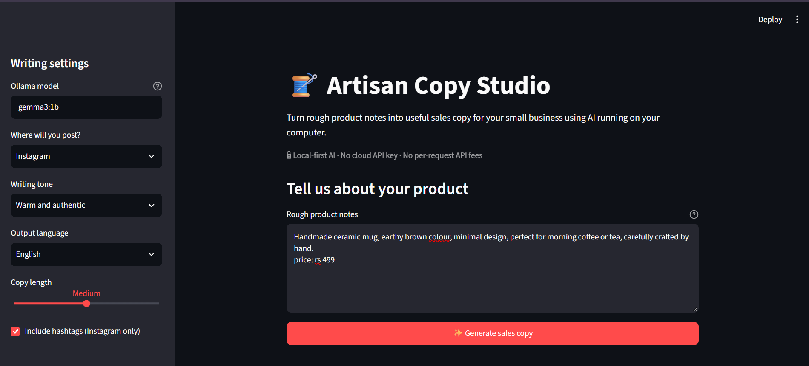
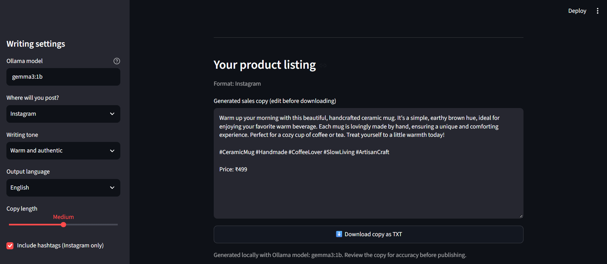

# 🧵 Artisan Copy Studio

A local AI-powered sales copy generator for artisans and small businesses.

Built for the Hacktoberfest DEV Challenge — Week 2: Side Hustle.

## 💡 About the Project

Small business owners and artisans often need to write product descriptions for different online platforms.

Artisan Copy Studio helps turn rough product notes into sales copy using a locally running AI model, without requiring a paid cloud API.

## 📸 App Preview

### 1. Product Input



### 2. Generated Sales Copy



---

## ✨ Features

- Generate sales copy from product notes
- Platform-specific formats for Instagram, WhatsApp, Etsy, and Facebook Marketplace
- Multiple writing tones
- English, Hindi, and Hinglish output options
- Adjustable copy length
- Download generated copy as a text file
- Local AI inference through Ollama

## 🛠️ Tech Stack

- Python
- Streamlit
- Ollama
- Gemma 3 (1B)

## 🚀 Getting Started

### Prerequisites

- Python installed
- Ollama installed
- The Gemma model downloaded

Pull the model if needed:

```bash
ollama pull gemma3:1b
```

### Installation

Clone the repository:

```bash
git clone https://github.com/yashraj05singh1107-coder/artisan-copy-studio.git
cd artisan-copy-studio
```

Create and activate a virtual environment:

```bash
python -m venv .venv
```

Windows PowerShell:

```powershell
.\.venv\Scripts\Activate.ps1
```

Install dependencies:

```bash
pip install -r requirements.txt
```

Run the application:

```bash
streamlit run app.py
```

## 🔐 Privacy and Cost

The application sends generation requests to the local Ollama service running on your computer. It does not require a paid cloud AI API key.

The model must be downloaded first. Once installed, generation can run locally without sending prompts to a cloud AI provider.

## ⚠️ Note

AI-generated content may contain inaccurate product claims. Review the generated copy before publishing it.

## 🔮 Future Improvements

- Stronger fact and price validation
- Support for multiple products
- Additional export formats
- Improved platform-specific output validation

## 📄 License

MIT
